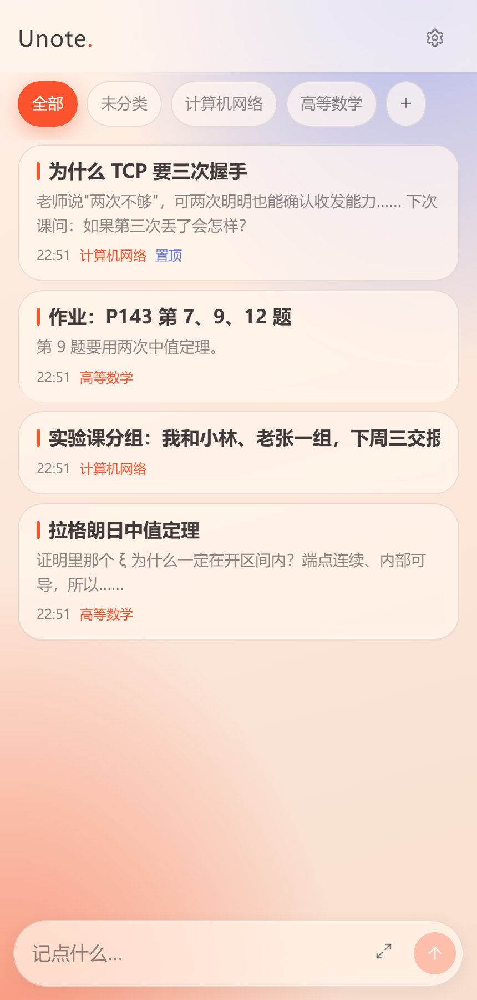

# Unote

一个只用来上课记笔记的小 App。

## 为什么会有这个

我不爱带笔记本上课，手机自带的备忘录又不太够用：不支持 Markdown，排版也就那样。

更主要的原因是——我不想把"记笔记"和平时刷手机的那些东西放在一起。打开手机就是一堆消息和推送，很难安静地写两行字。

于是就自己写了一个。没什么宏大的目标，就是想在上课那几分钟里，顺手把脑子里的问题记下来，回头还找得到。

名字就是 u + note 拼的，没什么深意。

## 长这样

<p align="center">
  
  
</p>

## 现在能做的

- 打开直接回到上一篇，光标在末尾，不用点"新建"
- 底部一条输入框，写完回车就存下
- Markdown 和图片，写完可以切到渲染后的样子看排版
- 按课程分开，新建时自动落在你正在看的那门课，不用选
- 壁纸、模糊、透明度都能自己拖
- 删掉的笔记进回收站，30 天内捡得回来
- 导出成 zip，里面就是一堆 `.md` 和图片，换手机时导入就行

## 下载

到 [Releases](https://github.com/XiJi-SUNSET/unote/releases/latest) 下最新的 apk，安装时允许"安装未知应用"就好。

- 大概 4 MB，Android 8.0 起
- 现在是 debug 签名，自己日常用没问题，但上不了应用商店

## 关于"不联网"

安装包里没有申请 `INTERNET` 权限，装完可以去系统的应用信息里自己确认。

笔记都在这台手机的本地数据库里。换手机靠导出 zip 再导入，没有云端，也没有账号。

## 自己跑

需要 Node 22 和 pnpm：

```bash
pnpm install
pnpm dev           # 浏览器里跑，数据存在浏览器的本地数据库
pnpm test
pnpm android:sync  # 把网页产物同步进 Android 工程
```

apk 是 GitHub Actions 构建的：推一个 `v*` 的 tag，会自动出包并挂到 Release 上，本地不用装 Android SDK。

## 几句话

- 不做账号、不做同步、不做 AI。不是清高，是这些东西一加上，"打开就能写"这件事就不成立了。
- 代码是 MIT，想改就改，想拿去给自己做一个也行。
- 如果你也用得上，那挺好。
